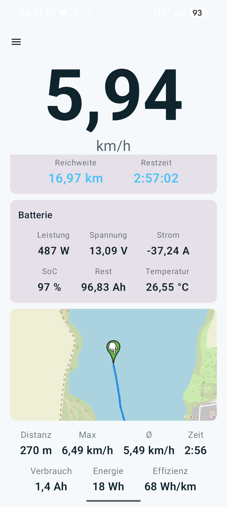
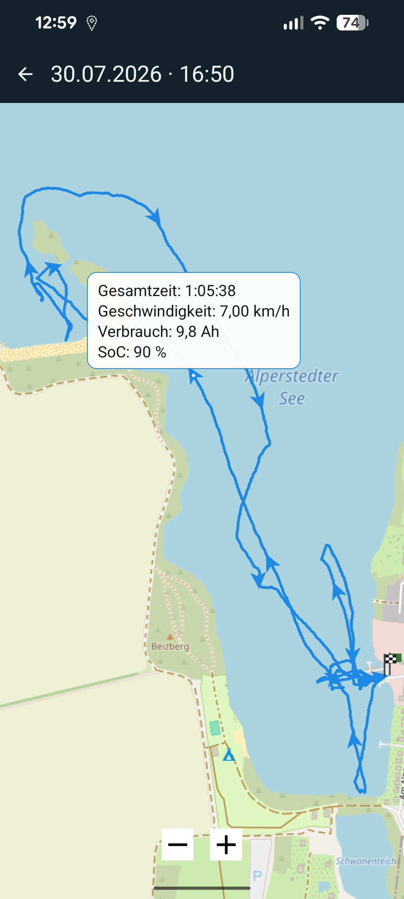
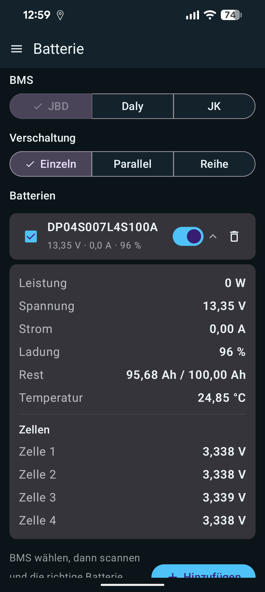
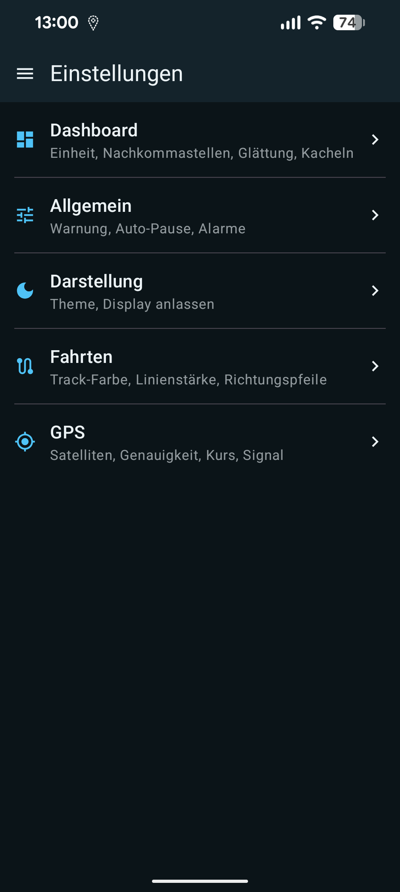

# BoatSpeedy

**GPS-Bootstacho und Navigation für kleine Boote.** Mit Motor, mit Paddel, mit Riemen.
Routen entlang der Wasserwege, im Kanu auch ums Wehr herum. Mit Bluetooth-BMS oder
Coulometer am Akku kommen Live-Werte und Reichweite dazu.

**Website:** [boatspeedy.wozise.de](https://boatspeedy.wozise.de/) · [Kanu-Routenplaner](https://boatspeedy.wozise.de/kanu-routenplaner/) ·
[Routenplaner für Wasserwege](https://boatspeedy.wozise.de/routenplaner-wasserwege/)

[](https://github.com/Glenn-Dandy/BoatSpeedy/actions/workflows/build.yml)


🇬🇧 [English](#english) · 🇩🇪 **Deutsch**

<p align="center">
  
  
  
  
</p>

Ohne Akku fehlt nur die Batteriekachel, alles andere braucht nur das Handy.

## Navigation

Langer Druck auf die Karte setzt ein Ziel, als Luftlinie oder **Route entlang der
Wasserwege**, mit Entfernung und geschätztem Verbrauch in Amperestunden.

**Kartendaten.** Die Wasserwege liegen als Kacheln auf dem Gerät, ein Grad breit und hoch.
Ganz Europa sind 1376 Kacheln und 176 MB, ein Umkreis von 150 km rund 20 Kacheln und
3,4 MB. Daraus rechnet das Handy die Route selbst, bis 600 km. Ohne Kacheln geht es über
Overpass, bis 60 km. Die Kacheln kommen aus OpenStreetMap, siehe
[boatspeedy-mapdata](https://github.com/Glenn-Dandy/boatspeedy-mapdata). Der Kartenserver
lässt sich unter Navigation, Kartendaten wechseln.

**Fahrzeug.** Motorboot oder Kanu entscheidet, welche Verbote gelten. `access`, `boat`,
`motorboat` und `canoe` werden gestuft gelesen, das Genauere gewinnt. Fürs Kanu ist ein
nacktes `boat=no` nur ein Hinweis: Solche Abschnitte kosten bei der Wegsuche das Dreifache
und werden rot gezeichnet.

**Auf der Karte.** Brücken mit Durchfahrtshöhe und Anleger ab Zoomstufe 11, Schleusen,
Wehre und Wasserkraftanlagen ab 13, auch ohne Route. Eine Schleuse antippen zeigt
Öffnungszeiten, Telefon, Funkkanal und Kammermaß aus OpenStreetMap. Seezeichen sind
antippbar, Winkel auf den Flüssen zeigen die Fließrichtung.

**Pegel und Meldungen.** Ab Zoomstufe 10 zeigt die Karte Pegel mit Wasserstand
(PEGELONLINE) und die Schifffahrtsmeldungen von ELWIS: Sperrungen und Einschränkungen an
Bundeswasserstraßen. Meldungen an der Route bleiben in jeder Zoomstufe sichtbar. Eine
Schleuse zeigt dazu ihre Betriebszeiten laut ELWIS, unverändert und mit Quelle.

**Wehre und Umtragen.** Ein Wehr sperrt die Route nicht, es kostet: Schleusen und
Umtragungen gehen vor. Im Kanu geht die Route ums Wehr herum, über Umtragewege aus
OpenStreetMap oder von Anleger zu Anleger. Durch Wasserkraftanlagen führt sie nie.

**Routen speichern und nachfahren.** Gerechnete Routen und aufgezeichnete Fahrten lassen
sich speichern, teilen und nachfahren.

**Karte.** Norden oben oder Fahrtrichtung oben. Marker und Karte gleiten zwischen den
Messungen, die aufgezeichnete Fahrt bleibt bei den rohen Werten.

## Tempo und Fahrt

- Dashboard mit großer Geschwindigkeit, übrige Kacheln anordnen und ausblenden, Karte in
  vier Größen
- km/h oder Knoten, Nachkommastellen `xx`, `xx.x`, `xx.xx`
- Misst über einen Vordergrunddienst auch bei ausgeschaltetem Display
- Trip-Distanz und Statistik (Max, Mittel, Zeit)
- Satelliten- und GPS-Status, Glättung bei langsamer Fahrt
- Auto-Pause nur bei wenig Strom **und** Stillstand

## Batterie (Bluetooth LE)

- Mehrere Akkus gleichzeitig, Verschaltung Einzeln, Parallel oder Reihe
- Live: Spannung, Strom, Ladezustand, Rest-Ah, Temperatur
- Reichweite und Restzeit beim aktuellen Tempo, gemittelt (aus, 15, 30, 60 s)
- Ladezyklen und insgesamt entnommene Ah, wo das BMS sie liefert
- Lademodus: schaltet GPS ab, zeigt "Voll in", meldet bei gewähltem Ladestand
- BMS: JBD/Jiabaida und Redodo/LiTime/Power Queen an Hardware geprüft, Daly und JK/Jikong
  experimentell
- **Coulometer mit Hall-Sensor** für Akkus ohne eigenes Bluetooth

## Fahrten und Wetter

- Fahrtenhistorie mit Distanz, Zeiten, Ah, Wh und Wh/km
- Track-Karte, Track antippen zeigt Tempo, Verbrauch, SoC, Strom und Leistung
- GPX exportieren und importieren
- DWD-Regenradar (animiert bis +100 min), Messwerte der nächsten Station, Wind
- DWD-Warnungen bei Gewitter und Sturm
- Ankerwache mit Alarm bei Abdrift

## Stand

| Bereich | Stand |
|---|---|
| GPS-Tempo, Fahrt, Statistik | ✅ läuft |
| JBD, Redodo/LiTime/Power Queen | ✅ an Hardware geprüft |
| Coulometer mit Hall-Sensor | ✅ an Hardware geprüft |
| Routing, Kacheln, Schleusen | ✅ im Feld geprüft (Saale, Rhein, Main) |
| Umtragen, Wasserkraftanlagen | ✅ geprüft an der Saale |
| Daly-BMS | ⚠️ experimentell, ungetestet |
| JK/Jikong-BMS | ⚠️ experimentell, ungetestet |
| Reihe und Parallel mehrerer Akkus | ⚠️ ungetestet an echtem Aufbau |

Die Route ist ein Vorschlag aus OpenStreetMap, kein Fahrwasser. Tiefen stehen dort nicht.

Offenes in [`TODO.md`](TODO.md), Änderungen in [`CHANGELOG.md`](CHANGELOG.md).

## Installieren

Über [F-Droid](https://f-droid.org/packages/de.kewl.boatspeedy/) oder als
`BoatSpeedy-…-release.apk` aus dem
[neuesten Release](https://github.com/Glenn-Dandy/BoatSpeedy/releases/latest). Beide
tragen dieselbe Signatur und lassen sich übereinander installieren. Meldet Play Protect
"Unsichere App blockiert": **Weitere Details**, **Trotzdem installieren**.

## Bauen

Braucht JDK 17 und das Android SDK.

```bash
./gradlew assembleDebug      # Debug-APK
./gradlew assembleRelease    # signierte Release-APK, braucht keystore.properties
./gradlew test               # Unit-Tests
```

Die Bauten sind reproduzierbar: kein `vcsInfo`, keine `dependenciesInfo`.

## Berechtigungen

| | |
|---|---|
| `ACCESS_FINE_LOCATION`, `ACCESS_COARSE_LOCATION` | GPS für Tempo und Satelliten |
| `FOREGROUND_SERVICE`, `…_LOCATION` | Messen während der Fahrt |
| `POST_NOTIFICATIONS` | Fahrt, Anker, Wetter, Laden |
| `INTERNET`, `ACCESS_NETWORK_STATE` | Karte, Wetter, Kartendaten, Pegel, Meldungen, Update-Prüfung |
| `BLUETOOTH_SCAN` (neverForLocation), `BLUETOOTH_CONNECT` | Batterie |

Kein `ACCESS_BACKGROUND_LOCATION`, keine Google Play Services.

## Datenquellen

- Karten und Wasserwege: © OpenStreetMap-Mitwirkende (ODbL)
- Seezeichen: OpenSeaMap (CC BY-SA)
- Regenradar, Blitze, Warnungen: Deutscher Wetterdienst (CC BY 4.0), Warnungen über Bright Sky
- Pegel: PEGELONLINE der WSV (DL-DE Zero 2.0)
- Schifffahrtsmeldungen und Betriebszeiten der Schleusen: ELWIS (www.elwis.de)

## Lizenz

MIT, siehe [LICENSE](LICENSE).

---

## English

🇬🇧 **English** · [🇩🇪 Deutsch](#boatspeedy)

**GPS boat speedometer and navigation for small boats.** Under motor, paddle or oars.
Routes along the waterways, around the weir by canoe. A Bluetooth BMS or a coulometer on
the pack adds live values and range.

**Website:** [boatspeedy.wozise.de](https://boatspeedy.wozise.de/en/) · [Canoe route planner](https://boatspeedy.wozise.de/en/canoe-route-planner/) ·
[Waterway route planner](https://boatspeedy.wozise.de/en/waterway-route-planner/)

Without a battery you only lose the battery tile, the rest needs nothing but the phone.

### Navigation

A long press on the map sets a destination, as a straight line or a **route along the
waterways**, with distance and estimated amp hours.

**Map data.** The waterways sit on the device as tiles, one degree wide and tall. All of
Europe is 1376 tiles and 176 MB, a 150 km radius about 20 tiles and 3.4 MB. The phone
computes the route itself, up to 600 km. Without tiles it uses Overpass, up to 60 km. The
tiles are built from OpenStreetMap, see
[boatspeedy-mapdata](https://github.com/Glenn-Dandy/boatspeedy-mapdata). The map server
can be changed under Navigation, Map data.

**Craft.** Motorboat or canoe decides which bans apply. `access`, `boat`, `motorboat` and
`canoe` are read as a graded set, the more specific one wins. For a canoe a bare
`boat=no` is only a hint: such sections cost triple and are drawn in red.

**On the map.** Bridges with a clearance height and landings from zoom 11, locks, weirs
and hydro power plants from 13, with no route set. Tapping a lock shows opening hours,
phone, VHF channel and chamber size from OpenStreetMap. Seamarks are tappable, chevrons on
rivers show the flow.

**Gauges and notices.** From zoom 10 the map shows gauges with water levels (PEGELONLINE)
and the ELWIS notices to skippers: closures and restrictions on German federal waterways.
Notices along the route stay visible at every zoom. A lock also shows its operating hours
from ELWIS, verbatim and with the source.

**Weirs and portage.** A weir does not block the route, it costs: locks and portages win.
In a canoe the route goes around the weir, along portage paths from OpenStreetMap or from
landing to landing. It never runs through a hydro power plant.

**Save and follow routes.** Planned routes and recorded trips can be saved, shared and
followed.

**Map.** North up or course up. Marker and map glide between fixes, the recorded track
keeps the raw values.

### Speed and trip

- Dashboard with a large speed readout, other tiles arranged and hidden, map in four sizes
- km/h or knots, decimals `xx`, `xx.x`, `xx.xx`
- Keeps measuring with the screen off through a foreground service
- Trip distance and stats (max, average, elapsed)
- Satellite and GPS status, smoothing at low speed
- Auto-pause only when the current is low **and** the boat is still

### Battery (Bluetooth LE)

- Several packs at once, wired single, parallel or series
- Live voltage, current, state of charge, remaining Ah, temperature
- Range and remaining time at the current speed, averaged (off, 15, 30, 60 s)
- Charge cycles and total discharge where the BMS reports it
- Charging mode: turns GPS off, shows time to full, alerts at a chosen level
- BMS: JBD/Jiabaida and Redodo/LiTime/Power Queen verified on hardware, Daly and JK/Jikong
  experimental
- **Coulometer with a Hall sensor** for packs without Bluetooth of their own

### Trips and weather

- Trip history with distance, times, Ah, Wh and Wh/km
- Track map, tap the track for speed, draw, SoC, current and power
- GPX export and import
- DWD rain radar (animated to +100 min), readings from the nearest station, wind
- DWD warnings for thunderstorm and storm
- Anchor watch with a drag alarm

### Status

| Area | Status |
|---|---|
| GPS speed, trip, stats | ✅ working |
| JBD, Redodo/LiTime/Power Queen | ✅ verified on hardware |
| Coulometer with Hall sensor | ✅ verified on hardware |
| Routing, tiles, locks | ✅ field-tested (Saale, Rhine, Main) |
| Portage, hydro power plants | ✅ tested on the Saale |
| Daly BMS | ⚠️ experimental, untested |
| JK/Jikong BMS | ⚠️ experimental, untested |
| Series and parallel packs | ⚠️ untested on a real setup |

A route is a suggestion from OpenStreetMap, not a fairway. Depths are not in it.

Open items in [`TODO.md`](TODO.md), changes in [`CHANGELOG.md`](CHANGELOG.md).

### Install

From [F-Droid](https://f-droid.org/packages/de.kewl.boatspeedy/) or as
`BoatSpeedy-…-release.apk` from the
[latest release](https://github.com/Glenn-Dandy/BoatSpeedy/releases/latest). Both carry
the same signature and install over each other. If Play Protect says "Unsafe app
blocked": **More details**, **Install anyway**.

### Build

Needs JDK 17 and the Android SDK.

```bash
./gradlew assembleDebug      # debug APK
./gradlew assembleRelease    # signed release APK, needs keystore.properties
./gradlew test               # unit tests
```

Builds are reproducible: no `vcsInfo`, no `dependenciesInfo`.

### Data sources

- Maps and waterways: © OpenStreetMap contributors (ODbL)
- Seamarks: OpenSeaMap (CC BY-SA)
- Rain radar, lightning, warnings: Deutscher Wetterdienst (CC BY 4.0), warnings via Bright Sky
- Gauges: PEGELONLINE of the WSV (DL-DE Zero 2.0)
- Notices to skippers and lock operating hours: ELWIS (www.elwis.de)

### License

MIT, see [LICENSE](LICENSE).
